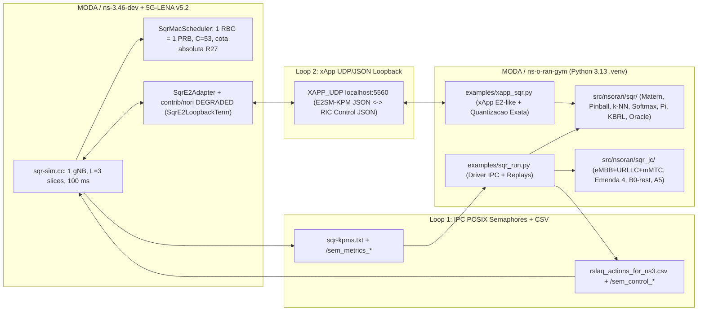

# Jussi_SBRC — Reprodução, Auditoria 3GPP/O-RAN e Extensão de *Safe RAN Slicing* (SQR)

[](MODA/ns-3-dev/)
[](MODA/docs/patches_nr/README.md)
[](MODA/ns-o-ran-gym/)
[](MODA/ns-o-ran-gym/tests/run_sqr_tests.sh)
[](MODA/docs/sqr/fase5.2-port-nori.md)
[](MODA/docs/sqr/)

Reimplementação, auditoria técnica empírica/normativa e extensão multi-serviço do método **SQR (*Safe Quantile Regression*)** — aprendizado por reforço baseado em modelo (MBRL) com regressão quantílica kernelizada online (sem rede neural) — sobre a plataforma **MODA** (`ns-3.46-dev` + `5G-LENA v5.2-dev` + `ns-o-ran-gym` em Python 3.13 + port `contrib/nori`, suíte com `360` testes passando).

- **Artigo base (SQR):** A. Tuerxun & A. Nakao, *"Safe RAN Slicing in O-RAN: Minimizing SLA Violations via Model-Based Reinforcement Learning"*, **IEEE CCNC 2026**, DOI [`10.1109/CCNC65079.2026.11366589`](https://doi.org/10.1109/CCNC65079.2026.11366589) (tradução verificada em [`tradução.md`](tradução.md)).
- **Baseline de comparação (KBRL):** J. J. Alcaraz et al., *"Model-Based Reinforcement Learning with Kernels for Resource Allocation in RAN Slices"*, **IEEE TWC 2022** ([`jjalcaraz-upct/network-slicing`](https://github.com/jjalcaraz-upct/network-slicing)).
- **Protocolo O-RAN (port parcial):** **NORI** ([`lasseufpa/nori`](https://github.com/lasseufpa/nori)), portado localmente para `ns-3.46` / `5G-LENA v5.2` em `MODA/ns-3-dev/contrib/nori/` (documentado em [`MODA/docs/sqr/fase5.2-port-nori.md`](MODA/docs/sqr/fase5.2-port-nori.md); diretórios `contrib/*` ficam sob `MODA/ns-3-dev/contrib/.gitignore`).

> **Escopo consolidado do repositório:** O projeto cobre (1) a reprodução rastreável do SQR e do KBRL em simulador 3GPP NR de nível de sistema com verificação estrita de cota no escalonador MAC (`SqrMacScheduler`); (2) o desacoplamento funcional *xApp ↔ gNB* via interface E2 simulada em modo `DEGRADED`; (3) a extensão para o cenário heterogêneo **eMBB + URLLC + mMTC** (`R = 300 m`); e (4) uma auditoria técnica linha a linha e normativa (`17/11/2026`) que delimita exatamente o que está validado, o que depende de premissas `[ASSUMIDO]` e quais bugs/limitações permanecem mapeados nos artefatos congelados.

---

## 1. Arquitetura e Estrutura de Diretórios

O ambiente executa o loop de controle de janela fixa (`100 ms`) por **dois caminhos de transporte equivalentes** sobre o mesmo cenário C++ (`sqr-sim.cc`) e o mesmo escalonador com cota absoluta (`SqrMacScheduler`, `1 RBG = 1 PRB`, `C = 53` PRBs, Gate `R27`):



### Estrutura principal do repositório

```text
.
├── AGENTS.md                              # Regras operacionais, mapa de paths e contratos
├── PLANO_IMPLEMENTACAO_SQR_NORI.md        # Plano das Fases 0–5 (SQR + KBRL + NORI)
├── tradução.md                            # Tradução verificada do artigo IEEE CCNC 2026
├── docs/
│   ├── artigo/                            # Relatórios de validação (G4-A/G4-B, estrutura, SLAs)
│   └── literature/                        # Síntese bibliográfica e matriz de gaps
└── MODA/
    ├── docs/
    │   ├── patches_nr/                    # Backups de patches defensivos e README do contrib/nr
    │   └── sqr/                           # Rastreabilidade, premissas, contrato e auditorias (17/11/2026)
    │       ├── source_traceability.md
    │       ├── assumptions_register.md
    │       ├── contrato_interface.md
    │       ├── fase5.2-port-nori.md / fase5.3-ric-control-adapter.md / fase5.4-xapp-sqr-paridade.md
    │       ├── auditoria_bugs_ns3_sqr_base_2026-11-17.md
    │       ├── auditoria_especialista_oran_3gpp_2026-11-17.md
    │       ├── validacao_pesquisador_senior_2026-11-17.md
    │       └── jc_decision/               # Protocolos congelados (Emenda 4, B0-rest, A5, Gate Contextual)
    ├── ns-3-dev/
    │   ├── scratch/sqr/                   # sqr-sim.cc, SqrMacScheduler, SqrE2Adapter, smoke_test.sh, ns3_gate.sh
    │   └── contrib/nori/                  # Port NORI local (55 arq.; contrib/* sob .gitignore)
    └── ns-o-ran-gym/
        ├── src/nsoran/sqr/                # Núcleo SQR, KBRL (Projectron), estáticos, oracle/, campaign_analysis.py
        ├── src/nsoran/sqr_jc/             # Extensão heterogênea (het_runtime.py, sla_margin.py, B0/A5)
        ├── examples/                      # Drivers sqr_run.py, xapp_sqr.py e wrappers run_sqr_*.sh
        └── tests/                         # Suíte Pytest (run_sqr_tests.sh: 360 testes; run_full_tests.sh)
```

---

## 2. Matriz de Auditoria vs. Artigo Base (CCNC 2026)

Classificação rastreada diretamente em [`MODA/docs/sqr/source_traceability.md`](MODA/docs/sqr/source_traceability.md), [`MODA/docs/sqr/assumptions_register.md`](MODA/docs/sqr/assumptions_register.md) e nos três relatórios de auditoria de `17/11/2026`.

### 2.1 ✅ Implementado e Fiel à Especificação Publicada (Seções III–IV, Algoritmo 1, Tabela I)

| Bloco do Artigo | Especificação Publicada (`[ARTIGO]`) | Implementação no Repositório |
|---|---|---|
| **Sistema e topologia** | `1` gNB, $L = 3$ slices eMBB, passo de `100 TTIs = 100 ms` ($\mu = 0$, slot `1 ms`), chegadas Poisson `2 UEs/min`, sessão exponencial média `60 s` | [`MODA/ns-3-dev/scratch/sqr/sqr-sim.cc`](MODA/ns-3-dev/scratch/sqr/sqr-sim.cc) |
| **Estado e entrada** | Local $s_t^{(i)} \in \mathbb{R}^4$ (`lowest throughput`, nº UEs, fila, SNR) + *mean-field* global $\bar{s}_t \in \mathbb{R}^2$ (cota das outras slices, total UEs) $\Rightarrow z_t^{(i)} \in \mathbb{R}^6$, $x_t^{(i)} = [z_t^{(i)}, a_t^{(i)}/C] \in \mathbb{R}^7$ | [`sqr_env.py`](MODA/ns-o-ran-gym/src/nsoran/sqr/sqr_env.py) (`SqrObservationBuilder`) |
| **KPI e SLA per-UE** | $y_t^{(i)} = p_5$ do throughput por UE na janela; $\Lambda = (0{,}5;\ 1{,}0;\ 1{,}5)$ Mbps/UE; meta $\delta = 1\%$; avaliação per-UE com exclusão de janelas sem UEs ativos (`R18`, `R19`) | [`sqr_kpis.py`](MODA/ns-o-ran-gym/src/nsoran/sqr/sqr_kpis.py) |
| **Regressor quantílico online** | Kernel **Matérn** normalizado ($k(x,x)=1$); incerteza $\sigma_t^{(i)}(x) = 1 - \max_j k(x, x_j)$; orçamento $B = 2000$; $\eta = 0{,}1$; *pinball loss* assimétrica ($\alpha_{UP}=\eta\tau$, $\alpha_{OP}=\eta(\tau-1)$); falha crítica $\alpha_{CF} = \alpha_{OP} \cdot P_{\text{penalty}}$ com $P_{\text{penalty}} = 2$ ativa em $\gamma \in \{0, 1\}$ (`R25`) | [`kernel.py`](MODA/ns-o-ran-gym/src/nsoran/sqr/kernel.py), [`quantile_regressor.py`](MODA/ns-o-ran-gym/src/nsoran/sqr/quantile_regressor.py) |
| **Política hierárquica** | Conjunto seguro $\mathcal{A}_{\text{safe},t}^{(i)} = \{a : f_\tau(z,a) \ge \Lambda^{(i)}\}$; Modo Confiante $\arg\max (f_\tau - \gamma \cdot a/C)$ para $\gamma \in \{0, 1\}$; Modo Incerto com Softmax ($\epsilon = 0{,}1$) ou *Safety-First* $k$-NN ($K = 10$ sucessos); margem $a \leftarrow a + \text{round}(\sigma \cdot M)$ | [`sqr_controller.py`](MODA/ns-o-ran-gym/src/nsoran/sqr/sqr_controller.py) |
| **Projeção, atualização e adaptação** | Projeção proporcional inteira $\Pi$ ($\sum a_i \le C$); atualização real em $(z_t, a_{\text{final},t}, y_t)$ (Algoritmo 1); atualização virtual negativa pré-projeção; adaptação dinâmica de $\tau_t \in [0{,}01;\ 0{,}05]$ e $M_t$ | [`coordinator.py`](MODA/ns-o-ran-gym/src/nsoran/sqr/coordinator.py), [`sqr_controller.py`](MODA/ns-o-ran-gym/src/nsoran/sqr/sqr_controller.py) |
| **Execução de cota no MAC** | Cota absoluta de PRBs por slice sem renormalização (`Σa < C ⇒ RBGs ociosos`); `1 RBG = 1 PRB` (`C = 53`), validado pelo Gate `R27` (i–iv) | [`sqr-mac-scheduler.cc`](MODA/ns-3-dev/scratch/sqr/sqr-mac-scheduler.cc) (`SqrMacScheduler`) |
| **Baselines e análise** | Port fiel do **KBRL** (`Projectron` + kernel Gaussiano + augmentação monotônica) e estáticos (`equal`, `prop`); geração das réplicas das Figs. 2–4 e tabelas com IC 95% *bootstrap* por *seed* | [`kbrl/`](MODA/ns-o-ran-gym/src/nsoran/sqr/kbrl/), [`static_controllers.py`](MODA/ns-o-ran-gym/src/nsoran/sqr/static_controllers.py), [`campaign_analysis.py`](MODA/ns-o-ran-gym/src/nsoran/sqr/campaign_analysis.py) |

### 2.2 ⚠️ Implementado sob Premissas Explícitas (`[ASSUMIDO]` — parâmetros omitidos no PDF)

O artigo base não identifica o simulador e omite mais de 12 parâmetros essenciais. Todas as escolhas estão congeladas e justificadas em [`MODA/docs/sqr/assumptions_register.md`](MODA/docs/sqr/assumptions_register.md):

| ID | Parâmetro Omitido no PDF | Valor `[ASSUMIDO]` Adotado | Observação / Divergência Frente ao PDF |
|---|---|---|---|
| `R01`, `R02` | Largura de banda e capacidade $C$ | `10 MHz` ($\mu = 0$), $C = 53$ PRBs (alinhado a RBG via telemetria `total_prb`; variante `20 MHz`: $C = 104$ registrado em `R01`) | `53` resulta de `RbOverhead=4%` no `5G-LENA` (vs $N_{\text{RB}}=52$ na TS 38.104); Fig. 4 do PDF sugere eixo `0–100` RBs ($C \approx 100$). |
| `R14`, `R23` | Duração, *warm-up* e *seeds* | Episódio de `600 s` = `6.000` steps (`100 s` de *warm-up* descartados); `10` *seeds* pareadas por método | Figs. 2–3 do PDF exibem `10.000` steps; nº de execuções não publicado. |
| `R08` | Parâmetros do kernel Matérn | $\nu = 1{,}5$ (Matérn 3/2) e *length-scale* isotrópico $\ell = 1{,}0$ sobre features normalizadas em $[0,1]^7$ | Escalas e normalização fixas em `R09`/`R20`; ver impacto de $\ell=1,0$ em `BUG-02` (§3). |
| `R07` | Temperatura Softmax | $T_{\text{softmax}} = 1{,}0$ sobre escores $f_\tau$ em Mbps | — |
| `R10` | Regra de poda da memória ($B=2000$) | Descarte determinístico do vetor $j$ de menor influência $I_j = |\alpha_j| \cdot k(x_{\text{novo}}, x_j)$ (desempate: mais antigo) | PDF descreve apenas qualitativamente ("baixo impacto ou redundantes"); ver efeito assimétrico em `BUG-02`. |
| `R11` | Lei de adaptação $\tau_t$ e $M_t$ | Em blocos de $W = 100$ janelas (`10 s`) via taxa $v_W$ sobre $y_t = p_5 < \Lambda$: $\Delta\tau = 0{,}005$, $\tau_0 = 0{,}05$, $M_0 = 10 \in [2;\ 50]$ (dobra/divide por 2) | Equações, ganhos e sinal de disparo omitidos no PDF. |
| `R12` | Peso da atualização virtual pós-$\Pi$ | $\alpha_{\text{virt}} = -\eta_{\text{virt}} = -0{,}05$ ($=\eta/2$) por slice reduzida | PDF cita apenas "pequeno peso negativo"; `B0-rest` usa `virtual_alpha = 0.0` (ver `BUG-02`). |
| `R04` | Tráfego aplicativo | DL UDP *full-buffer* (*greedy*) `--ueOfferedMbps = 100` Mbps/UE (`1500 B`) | Direção, protocolo e tamanho de pacote não publicados no PDF. |
| `R05` | Mobilidade dos UEs | Pedestre `~1 m/s` (`3 km/h`), *random-walk* em caixa `[-R, R]^2` após sorteio em disco de raio $R$ | PDF informa apenas "trajetórias aleatórias por episódio". |
| `R19`, Fase 3 | Harmonização KBRL vs SQR | KBRL aprende indicador slice-tempo ($y_t = p_5 < \Lambda$); comparação reporta níveis UE-tempo (`R19`) e slice-tempo com denominadores explícitos | PDF compara ambos sem denominador comum declarado. |

### 2.3 ❌ O que NÃO está implementado (PDF, normas 3GPP/O-RAN completas e trabalhos futuros)

1. **Canal LTE simplificado do artigo base:** o `5G-LENA v5.2` não possui o pathloss **3GPP TR 36.942** ($\approx 139{,}4\text{ dB}$ @ `2 km`), o perfil de desvanecimento **Pedestrian A (TS 36.104)** nem piso fixo `Interference plus noise = -110 dBm` sem RLF. O simulador usa **3GPP TR 38.901 UMa** ($\approx 148{,}57\text{ dB}$ NLOS @ `2 km`), figura de ruído `NF = 9,0 dB` (sem interferência intercelular) e RLM (`Qout = -5 dB`) — explicando a transição de `+15,6 dB` analítico no modelo LTE simplificado ($\text{EIRP } 45 - 139{,}4 - (-110)$) para `-8,4 dB` mediano de borda ($45 - 148{,}57 - (-95{,}20)$) com RLF severo no 5G-LENA (`84,3%–89,9%` de violação em todos os métodos nos 40 runs a `2 km`).
2. **Decaimento regularizador NORMA e formato exato da Fig. 4:** o fator de encolhimento $(1 - \eta\lambda)\alpha_j$ não existe em [`quantile_regressor.py`](MODA/ns-o-ran-gym/src/nsoran/sqr/quantile_regressor.py), e [`campaign_analysis.py`](MODA/ns-o-ran-gym/src/nsoran/sqr/campaign_analysis.py) não gera *violin plots* na escala `0–100` PRBs (além da mistura de unidades em `BUG-04`).
3. **Sensibilidades abertas da Fase 4 no cenário base:** a campanha base a `2 km` foi executada apenas em `10 MHz` (`C = 53`) e chegadas `2 UEs/min` globais (não executou a matriz `20 MHz` / $C=104$ nem chegadas Poisson por slice = `6 UEs/min` globais no cenário homogêneo base, embora `--sliceLambdas` já exista desde a Rodada 2).
4. **Pilha O-RAN Near-RT RIC `FULL` (SCTP + ASN.1 PER + Kubernetes):** o port local `MODA/ns-3-dev/contrib/nori/` ([`fase5.2-port-nori.md`](MODA/docs/sqr/fase5.2-port-nori.md)) + [`xapp_sqr.py`](MODA/ns-o-ran-gym/examples/xapp_sqr.py) executa exclusivamente em modo **`NORI_DEGRADED=1`** (UDP/JSON *lockstep* em `localhost:5560`, $t_{\text{act}} = t_{\text{ind}}$ em tempo simulado, sem `e2sim` linkado nem Near-RT RIC O-RAN SC em k8s). O código `FULL` dormente em `contrib/nori/model/` possui não-conformidades e bloqueios ainda não corrigidos: erro sintático em `ccc-control-message.cc:95` (`{s`), E2SM-RC com *Control Style 1* em vez de *Control Style 2* para `Action ID 6` (sem `PLMN`/`SD` e usando `RICrequestID = 1003` como seletor), e E2SM-KPM com `noLabel` em vez de `MeasurementLabel.sliceID` (`S-NSSAI`), métrica não-padronizada `"DRB.NetworkSlicing.SST"`, `139` PRBs fixos e `buffer = 0`. Além disso, a ponte `DEGRADED` atual envia apenas 13 colunas KPM (incompatível com os atrasos por pacote de `sqr_jc/`).
5. **Mecanismos 3GPP NR canônicos completos:**
   - **TDD:** padrão legado `"D|D|8D|4GB|4U|U|U"` (`7 ms`, `3 DL + 1 S + 3 UL`) **não é válido na TS 38.331 §6.3.2** (que permite `{0.5..10}` ms divisores de `20 ms`, excluindo `7 ms`), quebra `AssignCsiRsOffset` e impôs quantização artificial de chegadas Poisson a múltiplos de `7 ms` (`R29`);
   - **QoS / 5QI / URLLC:** portador único `5QI = 9` (*Non-GBR*) para todas as slices (sem fluxos dedicados `5QI` GBR/DC-GBR da TS 23.501); ausência de mini-slots Tipo B, $\mu \ge 1$, preempção `DCI 2_1` ou duplicação PDCP (`urllcDeadlineMs = 10` é metadado offline); janela de `100 ms` vs `Default Averaging Window = 2000 ms`;
   - **RRM Slicing:** `SqrMacScheduler` implementa `Dedicated = Min = Max` rígido apenas em DL (sem pool compartilhado *work-conserving* da TS 28.541 §4.3.36 nem fatiamento UL); `resourceSharePct` reporta cota configurada e `snrDb` é proxy Shannon via CQI.
6. **Testbeds SDR físicos (*Future Work*, Seção VI do PDF):** **Colosseum** e **Arena** estão fora do escopo do projeto.

### 2.4 🚀 O que implementamos ALÉM do Artigo Base (Extensões do Projeto)

- **Isolamento MAC verificável e protocolo científico auditável:** [`SqrMacScheduler`](MODA/ns-3-dev/scratch/sqr/sqr-mac-scheduler.cc) com telemetria por janela (`prb_requested`, `prb_executed`, `prb_scheduled`, `prb_idle`, Gate `R27` i–iv) e separação estrita `[ARTIGO]` vs `[ASSUMIDO]`.
- **Desacoplamento arquitetural `xApp ↔ gNB` via NORI (`DEGRADED`):** port local de 55 arquivos do `contrib/nori` para `ns-3.46` / `5G-LENA v5.2` ([`fase5.2-port-nori.md`](MODA/docs/sqr/fase5.2-port-nori.md); `MODA-PORT.md` local em `contrib/nori/docs/`) + `SqrE2Adapter` + `xapp_sqr.py`, com **paridade determinística bit-a-bit** validada contra o loop IPC (`3585/3585` decisões, `1199/1199` janelas PRB, `994 = 994` violações em `120 s`, `seed=1`, $\gamma=1$) e latência local `p50 = 2,39 ms` / `p95 = 9,28 ms` ($\ll 50\text{ ms}$).
- **Extensão multi-serviço heterogênea (`sqr_jc/`, prometida na Seção VI do PDF):** cenário calibrado **eMBB + URLLC + mMTC** a `R = 300 m` (`0` RLF, `SNR p5 >= 5 dB`), instrumentação de atraso E2E por pacote via `ByteTag` (`sqr_packet_delays.csv`, `0` pacotes sem tag no smoke), fechamento causal online sob feedback atrasado e censura MNAR documentada (`Emenda 4` em [`het_runtime.py`](MODA/ns-o-ran-gym/src/nsoran/sqr_jc/het_runtime.py), fechando `99,7%` dos pools saudáveis enquanto `4.579` janelas congestionadas permanecem `OPEN`), detector de viabilidade 3-way (`G4-B` em `9` *seeds* inéditas `1201–1209`: `FIR = 9,52%`, `FFR = 11,08% -> STOP FINAL`), replays contrafactuais bit-exatos (`A/A`) e auditoria completa de seleção conjunta (`B0-rest`, `A5 Gate 1` em `25` estados / `127` replays e `Gate Contextual G0–G2`).

---

## 3. Status das Auditorias Técnicas e Bugs Conhecidos (17/11/2026)

As auditorias independentes de `17/11/2026` mantiveram os artefatos congelados intactos (**modo somente-leitura**) e mapearam 6 achados principais (`BUG-01..06`, além de `BUG-07..10` médios) explicando anomalias observadas nos resultados históricos:

| ID | Severidade | Localização | Mecanismo e Impacto Nos Artefatos Congelados |
|---|---|---|---|
| **`BUG-01`** | Crítico | `rslaq-mac-scheduler.cc:1553-1556` | `BeforeDlSched` sobrescreve **`m_dlMcs == 0 -> 15` (`16-QAM`)**, destruindo todas as transmissões `CQI=1` (`0/68` janelas com vazão `>0` na `seed_1` a `2 km`; `8,4–17,8%` das alocações MAC em `MCS=15`, agravando RLF). Impacto **residual a `300 m`**, onde `SNR >= 5 dB` evita `CQI=0/1` em regime. |
| **`BUG-02`** | Crítico | `coordinator.py`, `quantile_regressor.py`, `kernel.py` | `alpha_virt = -0,05` (`10×–50×` maior que $\alpha_{UP}=\eta\tau$), kernel largo ($\ell=1,0$) e poda `I_j = |α_j|·k` sem decaimento NORMA colapsaram $f_\tau$ para **`[-12,4; -3,5]` Mbps** na `seed_1` a `2 km` (`confident = 0,00%` nas `179.850` decisões das 40 runs; $\gamma=0$ e $\gamma=1$ nunca atuaram). Evitado em `B0-rest` a `300 m` via `virtual_alpha = 0.0`. |
| **`BUG-03`** | Crítico | `sqr-sim.cc:1680-1802`, `sqr_controller.py:300-301`, `action_controller.py` | Dupla chamada `predict()+uncertainty()` e leitura $O(T^2)$ do CSV levaram `decision_time_ms` até `97,3 ms`, estourando `sem_timedwait(50 ms)` silenciosamente e causando **defasagem permanente de 1 passo em `18/20` runs SQR a `2 km`** (até `2.103` divergências) e nos passos finais da `seed 2103` de `B0-rest` (corte limpo `cut_step=1692` [`56,5%`] em $\lambda=5$ e `1473` [`49,2%`] em $\lambda=6$, i.e. **`43,5%–50,8%` pós-corte**). Os `25` estados + `127` replays do `Gate 1` foram extraídos estritamente pré-corte com **`0` dessincronia**. |
| **`BUG-04`** | Alto | `campaign_analysis.py:260-274, 433-470`, `sqr_run.py:1112` | Loop soma `prb_idle_est` nas 3 slices, **triplicando** a métrica (`74,96` e `76,75 > 53` PRBs), e plota `prb_scheduled` acumulado na janela (`RBG·slots/100ms`: `205–327`) no mesmo eixo que PRBs por slot (`0–53`) na Fig. 4. |
| **`BUG-05`** | Alto | `sqr_run.py:615, 1006-1021`, `xapp_sqr.py:558-568, 658-665` | Passo 1 do IPC decide com `C = 52` antes do sync para `53` (no `xapp_sqr.py` já inicia em `53`); `xapp_sqr.py` grava `learned`/`virtual_updates` estáticos e registra apenas o modo da slice 0 em `xapp_decisions.csv`. |
| **`BUG-06`** | Alto | `sqr_kpis.py:345-372`, `rslaq-mac-scheduler.cc:1066-1079` | Sentinela `snrDb = -999,0` (`23,8%–35,1%` das linhas KPM na `seed_1` a `2 km`) é imputada como mediana positiva/`15 dB`, ocultando UEs `CQI = 0` do estado $z_t$. |

**Ressalvas científicas adicionais da validação sênior ([`validacao_pesquisador_senior_2026-11-17.md`](MODA/docs/sqr/validacao_pesquisador_senior_2026-11-17.md)):**
- O *sweep* de raio (`300/800/1500/2000 m`) documentado anteriormente foi de `1` *seed* (`240 s`) e seus CSVs de `1500/2000 m` não estão persistidos em `results/` (há `3` *seeds* para `300/500/800 m` em `MODA/ns-o-ran-gym/results/sqr_characterization/validation/` e `10` *seeds* a `2000 m` na campanha).
- Na frente heterogênea, `B0-rest` (ajustado sobre `seed=2102`) sofreu queda de **`-27,24 p.p.`** em `STRICT_ALL3_R19` na `seed=2103` (`71,72% -> 44,48%` em $\lambda=5$), amplificada pela contração da fração `UNKNOWN` (`60,63% -> 24,14%`), e ambos os gates (`G4-B` `FFR=11,08%` em `9` *seeds* inéditas e `A5 Gate 1` com `N=18` `ALL3_COMPLETE`) encerraram em **`STOP` / `NO-GO`** para heurísticas/seletores acoplados sem telemetria intra-`100 ms`.

---

## 4. Reprodução Rápida, Testes e Documentação de Referência

> **⚠️ Atenção ao interpretador Python:** O wrapper `./ns3` do `ns-3.46-dev` falha no `argparse` do **Python 3.14** do sistema. Sempre compile e execute o `ns-3` via [`MODA/ns-3-dev/scratch/sqr/ns3_gate.sh`](MODA/ns-3-dev/scratch/sqr/ns3_gate.sh) (que fixa o **Python 3.13** do `uv`), e utilize o ambiente `.venv` (Python 3.13) para os scripts em `MODA/ns-o-ran-gym/`.

```bash
# 1. Build e smoke checks do ns-3 / 5G-LENA (network + IPC dummy + E2 loopback + R27 + soak)
bash MODA/ns-3-dev/scratch/sqr/ns3_gate.sh build
bash MODA/ns-3-dev/scratch/sqr/smoke_test.sh
bash MODA/ns-3-dev/scratch/sqr/run_e2_smoke.sh                 # gate E2 loopback (30 s, seed 1)

# 2. Suíte de testes Python (360 passed em run_sqr_tests.sh)
bash MODA/ns-o-ran-gym/tests/run_sqr_tests.sh                  # SQR, KBRL, Oracle, SQR-JC
bash MODA/ns-o-ran-gym/tests/run_full_tests.sh                 # suíte completa ns-o-ran-gym

# 3. Loop fechado (IPC vs E2) e campanha base
bash MODA/ns-o-ran-gym/examples/run_sqr_integration.sh         # SQR via IPC (120 s, seed 1)
bash MODA/ns-o-ran-gym/examples/run_sqr_integration_kbrl.sh    # KBRL via IPC (60 s, seed 1)
bash MODA/ns-o-ran-gym/examples/run_sqr_e2_parity.sh           # paridade IPC vs xApp E2 DEGRADED
JOBS=6 bash MODA/ns-o-ran-gym/examples/run_sqr_campaign.sh sqr-g0,sqr-g1,kbrl,equal 1..10 600
bash MODA/ns-o-ran-gym/examples/run_sqr_analysis.sh MODA/ns-o-ran-gym/results/sqr_campaign --exclude-warmup
```

### Documentação de Referência

| Documento | Conteúdo |
|---|---|
| [`AGENTS.md`](AGENTS.md) | Guia operacional, arquitetura IPC, regras de ouro e status das fases |
| [`PLANO_IMPLEMENTACAO_SQR_NORI.md`](PLANO_IMPLEMENTACAO_SQR_NORI.md) | Plano completo (Fases 0–5), critérios de aceite e análise NORI |
| [`tradução.md`](tradução.md) | Tradução integral verificada do artigo SQR (IEEE CCNC 2026) |
| [`MODA/docs/sqr/source_traceability.md`](MODA/docs/sqr/source_traceability.md) | Mapeamento `[ARTIGO]` parâmetro → seção/tabela/equação |
| [`MODA/docs/sqr/assumptions_register.md`](MODA/docs/sqr/assumptions_register.md) | Registro `R01–R59` de premissas `[ASSUMIDO]` e decisões de calibração |
| [`MODA/docs/sqr/contrato_interface.md`](MODA/docs/sqr/contrato_interface.md) | Contrato congelado `v1.4` (KPM 13/17 colunas, ação, `sqr_packet_delays.csv`) |
| [`MODA/docs/sqr/fase5.4-xapp-sqr-paridade.md`](MODA/docs/sqr/fase5.4-xapp-sqr-paridade.md) | Paridade IPC × E2 `DEGRADED` (`3585/3585` decisões) e latências (`p50`/`p95`) |
| [`MODA/docs/sqr/auditoria_bugs_ns3_sqr_base_2026-11-17.md`](MODA/docs/sqr/auditoria_bugs_ns3_sqr_base_2026-11-17.md) | Auditoria linha a linha C++/Python (`BUG-01..10` e 10 subsistemas sãos) |
| [`MODA/docs/sqr/auditoria_especialista_oran_3gpp_2026-11-17.md`](MODA/docs/sqr/auditoria_especialista_oran_3gpp_2026-11-17.md) | Auditoria normativa 3GPP (`TR 38.901`, `TS 38.331`, `TS 23.501`, `TS 28.541/552`) e O-RAN |
| [`MODA/docs/sqr/validacao_pesquisador_senior_2026-11-17.md`](MODA/docs/sqr/validacao_pesquisador_senior_2026-11-17.md) | Parecer científico sênior, validade estatística e matriz *Reviewer #2* |
| [`MODA/docs/sqr/jc_decision/PROTOCOL_FROZEN_AMENDMENT_4_DELAYED_FEEDBACK.md`](MODA/docs/sqr/jc_decision/PROTOCOL_FROZEN_AMENDMENT_4_DELAYED_FEEDBACK.md) | Regra de fechamento causal URLLC sob feedback atrasado e censura MNAR |
| [`MODA/docs/sqr/jc_decision/B0_PRONTIDAO_E_CONGELAMENTO.md`](MODA/docs/sqr/jc_decision/B0_PRONTIDAO_E_CONGELAMENTO.md) | Congelamento de `B0-rest` (`SQR-HET`) e análise inter-seed (`2102` vs `2103`) |
| [`MODA/docs/sqr/jc_decision/A5_GATE1_RELATORIO_EXPLORATORIO.md`](MODA/docs/sqr/jc_decision/A5_GATE1_RELATORIO_EXPLORATORIO.md) | Gate 1 do seletor conjunto `A5` (`25` estados, `127` replays, `NO-GO`) |
| [`MODA/docs/sqr/jc_decision/GATE_CONTEXTUAL_PARECER_FINAL.md`](MODA/docs/sqr/jc_decision/GATE_CONTEXTUAL_PARECER_FINAL.md) | Parecer `G0–G2` sobre seleção contextual e originalidade bibliográfica |
| [`docs/artigo/G4B_validation_report.md`](docs/artigo/G4B_validation_report.md) | Validação `G4-B` em `9` *seeds* inéditas (`FFR = 11,08%`, `FIR = 9,52%`) |
