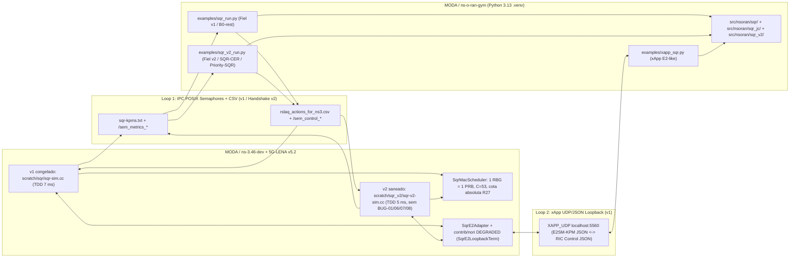

# Jussi_SBRC — Reprodução, Auditoria 3GPP/O-RAN e Extensão *SQR-CER* para *Safe RAN Slicing*

[](MODA/ns-3-dev/)
[](MODA/docs/patches_nr/README.md)
[](MODA/ns-o-ran-gym/)
[-brightgreen.svg)](MODA/ns-o-ran-gym/tests/run_sqr_tests.sh)
[](MODA/ns-o-ran-gym/tests/run_sqr_v2_tests.sh)
[](MODA/docs/sqr/fase5.2-port-nori.md)
[](MODA/docs/sqr/RELATORIO_CONSOLIDADO_LIMITACOES_NS3_3GPP_PESQUISA_2026-11-18.md)

Reimplementação fiel, auditoria técnica/normativa e extensão multi-serviço do método **SQR (*Safe Quantile Regression*)** — aprendizado por reforço baseado em modelo (MBRL) com regressão quantílica kernelizada online (sem rede neural) — sobre a plataforma **MODA** (`ns-3.46-dev` + `5G-LENA v5.2-dev` + `ns-o-ran-gym` em Python 3.13 + port `contrib/nori`), consolidada na linha **`v2`** saneada com o controlador proposto **`SQR-CER`** (*Constrained Elasticity Reallocation*).

- **Artigo base (SQR):** A. Tuerxun & A. Nakao, *"Safe RAN Slicing in O-RAN: Minimizing SLA Violations via Model-Based Reinforcement Learning"*, **IEEE CCNC 2026**, DOI [`10.1109/CCNC65079.2026.11366589`](https://doi.org/10.1109/CCNC65079.2026.11366589) (tradução verificada em [`tradução.md`](tradução.md)).
- **Baselines da literatura:**
  - **KBRL:** J. J. Alcaraz et al., *"Model-Based Reinforcement Learning with Kernels for Resource Allocation in RAN Slices"*, **IEEE TWC 2022** ([`jjalcaraz-upct/network-slicing`](https://github.com/jjalcaraz-upct/network-slicing)).
  - **Priority-SQR:** Hoashi, Ono & Nakao, **IEEE INFOCOM Wkshps 2026** (implementação isolada em [`priority_hoashi.py`](MODA/ns-o-ran-gym/src/nsoran/sqr_v2/priority_hoashi.py)).
- **Protocolo O-RAN (port parcial):** **NORI** ([`lasseufpa/nori`](https://github.com/lasseufpa/nori)), portado localmente para `ns-3.46` / `5G-LENA v5.2` em `MODA/ns-3-dev/contrib/nori/` (documentado em [`MODA/docs/sqr/fase5.2-port-nori.md`](MODA/docs/sqr/fase5.2-port-nori.md); `contrib/*` e `scratch/*` ficam sob `.gitignore` interno do `ns-3-dev`).

> **Escopo consolidado do repositório:** O projeto reúne (1) a linha histórica congelada **`v1`** (`B0_FROZEN_MANIFEST.json`: reprodução fiel do SQR e KBRL em `sqr-sim.cc`, desacoplamento *xApp ↔ gNB* em modo `NORI DEGRADED` e protótipo heterogêneo `sqr_jc/`); (2) a auditoria técnica/3GPP que identificou limitações físicas a `2000 m` e bugs `BUG-01..08` na pilha `v1`; e (3) a linha **`v2` saneada** (`sqr-v2-sim.cc`, padrão **TDD `5 ms` TS 38.331**, Handshake `v2` estrito, remoção de `BUG-01/04/06/07/08`, restauração do `Patch 1` em `nr-pdcp.cc`), o controlador proposto **`SQR-CER`**, a auditoria matemática de **conformidade física 3GPP** (`TS 38.104/214/306/331`, `TR 38.901`) e o comparativo pareado **Fiel vs. Adaptado**.

---

## 1. Arquitetura e Estrutura de Diretórios

O ambiente executa o loop de controle de janela fixa (`100 ms`) sobre o simulador 3GPP NR (`5G-LENA v5.2-dev`) com cota absoluta verificável no escalonador MAC (`SqrMacScheduler`, `1 RBG = 1 PRB`, `C = 53` PRBs efetivos em `10 MHz` com `RbOverhead = 4%`, Gate `R27`):



### Estrutura principal do repositório

```text
.
├── AGENTS.md                              # Regras operacionais, arquitetura IPC, regras de ouro e status
├── PLANO_IMPLEMENTACAO_SQR_NORI.md        # Plano das Fases 0–5 (SQR + KBRL + NORI)
├── tradução.md                            # Tradução verificada do artigo IEEE CCNC 2026
├── docs/literature/                       # Síntese bibliográfica e matriz de gaps (evidence-report.md, research-gaps.md)
└── MODA/
    ├── docs/
    │   ├── patches_nr/                    # Backups de patches defensivos do contrib/nr (Patches 1–4)
    │   └── sqr/                           # Rastreabilidade, premissas, contrato, plano v2 e auditorias 18/11/2026
    │       ├── source_traceability.md
    │       ├── assumptions_register.md
    │       ├── contrato_interface.md
    │       ├── PLANO_CORRECAO_INFRAESTRUTURA_V2.md
    │       ├── RELATORIO_CONSOLIDADO_LIMITACOES_NS3_3GPP_PESQUISA_2026-11-18.md
    │       ├── limitacoes_ns3_5glena_vazao_latencia_espectro_2026-11-18.md
    │       ├── limitacoes_3gpp_oran_vazao_latencia_espectro_2026-11-18.md
    │       ├── limitacoes_pesquisa_metodologia_resultados_2026-11-18.md
    │       ├── fase5.2-port-nori.md / fase5.3-ric-control-adapter.md / fase5.4-xapp-sqr-paridade.md
    │       ├── v2_infra/ETAPA2_RELATORIO_VALIDACAO_IPC_METRICAS.md
    │       └── jc_decision/B0_FROZEN_MANIFEST.json
    ├── ns-3-dev/
    │   ├── scratch/sqr/                   # Linha v1 congelada (sqr-sim.cc, SqrMacScheduler, SqrE2Adapter, ns3_gate.sh)
    │   ├── scratch/sqr_v2/                # Linha v2 saneada (sqr-v2-sim.cc, TDD 5 ms, conservação multi-beam, sem BUG-01/06/07)
    │   └── contrib/nori/                  # Port NORI local (55 arquivos em modo DEGRADED)
    └── ns-o-ran-gym/
        ├── src/nsoran/sqr/                # Núcleo SQR, KBRL (Projectron), estáticos (equal, prop), campaign_analysis.py
        ├── src/nsoran/sqr_jc/             # Infraestrutura heterogênea (het_runtime.py, sla_margin.py, feature_scaler.py)
        ├── src/nsoran/sqr_v2/             # Linha v2: controller_v2.py (L3 + NumPy <1ms), cer_reallocator.py, priority_hoashi.py, env_v2.py
        ├── examples/                      # Drivers sqr_run.py, sqr_v2_run.py, xapp_sqr.py, avaliações Fase 2/3 e auditoria 3GPP
        ├── results/sqr_v2/                # Artefatos finais v2 (comparativo_fiel_vs_adaptado, fase3_closed_loop, fase3_calibration, fase2)
        └── tests/                         # Suíte Pytest (run_sqr_tests.sh: v1 | run_sqr_v2_tests.sh: v2)
```

---

## 2. Matriz de Auditoria vs. Artigo Base (CCNC 2026)

Classificação rastreada diretamente em [`MODA/docs/sqr/source_traceability.md`](MODA/docs/sqr/source_traceability.md), [`MODA/docs/sqr/assumptions_register.md`](MODA/docs/sqr/assumptions_register.md) e no relatório consolidado [`RELATORIO_CONSOLIDADO_LIMITACOES_NS3_3GPP_PESQUISA_2026-11-18.md`](MODA/docs/sqr/RELATORIO_CONSOLIDADO_LIMITACOES_NS3_3GPP_PESQUISA_2026-11-18.md).

### 2.1 ✅ Implementado e Fiel à Especificação Publicada (Seções III–IV, Algoritmo 1, Tabela I)

| Bloco do Artigo | Especificação Publicada (`[ARTIGO]`) | Implementação no Repositório |
|---|---|---|
| **Sistema e topologia** | `1` gNB, $L = 3$ slices eMBB, passo de `100 TTIs = 100 ms` ($\mu = 0$, slot `1 ms`), chegadas Poisson `2 UEs/min`, sessão exponencial média `60 s` | [`MODA/ns-3-dev/scratch/sqr/sqr-sim.cc`](MODA/ns-3-dev/scratch/sqr/sqr-sim.cc) |
| **Estado e entrada** | Local $s_t^{(i)} \in \mathbb{R}^4$ (`lowest throughput`, nº UEs, fila, SNR) + *mean-field* global $\bar{s}_t \in \mathbb{R}^2$ (cota das outras slices, total UEs) $\Rightarrow z_t^{(i)} \in \mathbb{R}^6$, $x_t^{(i)} = [z_t^{(i)}, a_t^{(i)}/C] \in \mathbb{R}^7$ | [`sqr_env.py`](MODA/ns-o-ran-gym/src/nsoran/sqr/sqr_env.py) (`SqrObservationBuilder`) |
| **KPI e SLA per-UE** | $y_t^{(i)} = p_5$ do throughput por UE na janela; $\Lambda = (0{,}5;\ 1{,}0;\ 1{,}5)$ Mbps/UE; meta $\delta = 1\%$; avaliação per-UE com exclusão de janelas sem UEs ativos (`R18`, `R19`) | [`sqr_kpis.py`](MODA/ns-o-ran-gym/src/nsoran/sqr/sqr_kpis.py) |
| **Regressor quantílico online** | Kernel **Matérn** normalizado ($k(x,x)=1$); incerteza $\sigma_t^{(i)}(x) = 1 - \max_j k(x, x_j)$; orçamento $B = 2000$; $\eta = 0{,}1$; *pinball loss* assimétrica ($\alpha_{UP}=\eta\tau$, $\alpha_{OP}=\eta(\tau-1)$); falha crítica $\alpha_{CF} = \alpha_{OP} \cdot P_{\text{penalty}}$ com $P_{\text{penalty}} = 2$ ativa em $\gamma \in \{0, 1\}$ (`R25`) | [`kernel.py`](MODA/ns-o-ran-gym/src/nsoran/sqr/kernel.py), [`quantile_regressor.py`](MODA/ns-o-ran-gym/src/nsoran/sqr/quantile_regressor.py) |
| **Política hierárquica** | Conjunto seguro $\mathcal{A}_{\text{safe},t}^{(i)} = \{a : f_\tau(z,a) \ge \Lambda^{(i)}\}$; Modo Confiante $\arg\max (f_\tau - \gamma \cdot a/C)$ para $\gamma \in \{0, 1\}$; Modo Incerto com Softmax ($\epsilon = 0{,}1$) ou *Safety-First* $k$-NN ($K = 10$ sucessos); margem $a \leftarrow a + \text{round}(\sigma \cdot M)$ | [`sqr_controller.py`](MODA/ns-o-ran-gym/src/nsoran/sqr/sqr_controller.py) |
| **Projeção, atualização e adaptação** | Projeção proporcional inteira $\Pi$ ($\sum a_i \le C$); atualização real em $(z_t, a_{\text{final},t}, y_t)$ (Algoritmo 1); atualização virtual negativa pré-projeção; adaptação dinâmica de $\tau_t \in [0{,}01;\ 0{,}05]$ e $M_t$ | [`coordinator.py`](MODA/ns-o-ran-gym/src/nsoran/sqr/coordinator.py), [`sqr_controller.py`](MODA/ns-o-ran-gym/src/nsoran/sqr/sqr_controller.py) |
| **Execução de cota no MAC** | Cota absoluta de PRBs por slice sem renormalização (`Σa < C ⇒ RBGs ociosos`); `1 RBG = 1 PRB` (`C = 53`), validado pelo Gate `R27` (i–iv) | [`sqr-mac-scheduler.cc`](MODA/ns-3-dev/scratch/sqr/sqr-mac-scheduler.cc) (`SqrMacScheduler`) |
| **Baselines e análise** | Port fiel do **KBRL** (`Projectron` + kernel Gaussiano + augmentação monotônica) e estáticos (`equal`, `prop`); geração das réplicas das Figs. 2–4 e tabelas com IC 95% *bootstrap* por *seed* | [`kbrl/`](MODA/ns-o-ran-gym/src/nsoran/sqr/kbrl/), [`static_controllers.py`](MODA/ns-o-ran-gym/src/nsoran/sqr/static_controllers.py), [`campaign_analysis.py`](MODA/ns-o-ran-gym/src/nsoran/sqr/campaign_analysis.py) |

### 2.2 ⚠️ Implementado sob Premissas Explícitas (`[ASSUMIDO]` — parâmetros omitidos no PDF)

O artigo base não identifica o simulador e omite parâmetros essenciais. Todas as escolhas estão congeladas e justificadas em [`MODA/docs/sqr/assumptions_register.md`](MODA/docs/sqr/assumptions_register.md):

| ID | Parâmetro Omitido no PDF | Valor `[ASSUMIDO]` Adotado | Observação / Divergência Frente ao PDF |
|---|---|---|---|
| `R01`, `R02` | Largura de banda e capacidade $C$ | `10 MHz` ($\mu = 0$), $C = 53$ PRBs (alinhado a RBG via telemetria `total_prb`; variante `20 MHz`: $C = 104$) | `53` resulta de `RbOverhead=4%` no `5G-LENA` (vs $N_{\text{RB}}=52$ na TS 38.104); Fig. 4 do PDF sugere eixo `0–100` RBs ($C \approx 100$). |
| `R14`, `R23` | Duração, *warm-up* e *seeds* | `600 s` (campanha base `v1`) / `90 s` (`25 s` warmup na `v2` e comparativo) | Figs. 2–3 do PDF exibem `10.000` steps; nº de execuções não publicado. |
| `R08` | Parâmetros do kernel Matérn | $\nu = 1{,}5$ (Matérn 3/2); `v1`: isotrópico $\ell = 1{,}0$; `v2` (`SQR-CER`): anisotrópico `L3` $\ell_a = [0{,}35;\ 0{,}20;\ 0{,}10]$ | Escalas e normalização fixas em `R09`/`R20`; `L3` corrige achatamento em `SQR-CER` (§3–§4). |
| `R07` | Temperatura Softmax | $T_{\text{softmax}} = 1{,}0$ sobre escores $f_\tau$ | — |
| `R10` | Regra de poda da memória ($B=2000$) | Descarte determinístico do vetor $j$ de menor influência $I_j = |\alpha_j| \cdot k(x_{\text{novo}}, x_j)$ (desempate: mais antigo) | PDF descreve apenas qualitativamente ("baixo impacto ou redundantes"). |
| `R11` | Lei de adaptação $\tau_t$ e $M_t$ | Blocos de $W = 100$ janelas (`10 s`) via taxa $v_W$: $\Delta\tau = 0{,}005$, $\tau_0 = 0{,}05$, $M_0 = 10 \in [2;\ 50]$ | Equações, ganhos e sinal de disparo omitidos no PDF. |
| `R12` | Peso da atualização virtual pós-$\Pi$ | $\alpha_{\text{virt}} = -\eta_{\text{virt}} = -0{,}05$ ($=\eta/2$) por slice reduzida | PDF cita apenas "pequeno peso negativo"; `B0-rest` usava `virtual_alpha = 0.0`. |
| `R04` | Tráfego aplicativo | DL UDP *full-buffer* (*greedy*) `--ueOfferedMbps = 100` Mbps/UE (`1500 B`) | Direção, protocolo e tamanho de pacote não publicados no PDF. |
| `R05` | Mobilidade dos UEs | Pedestre `~1 m/s` (`3 km/h`), *random-walk* em caixa `[-R, R]^2` após sorteio em disco de raio $R$ | PDF informa apenas "trajetórias aleatórias por episódio". |

### 2.3 ❌ Limitações Físicas / Normativas e Escopo Fora do Projeto

1. **Canal LTE simplificado vs. 3GPP TR 38.901 UMa:** o `5G-LENA v5.2` não implementa o pathloss **TR 36.942** nem piso fixo `-110 dBm` sem RLF. Em `3GPP TR 38.901 UMa` ($f_c = 2{,}0\text{ GHz}$, `30 dBm`, `15 dBi`, `NF = 9 dB`, `1×1 SISO`), a borda de `2000 m` apresenta SNR mediano NLOS de `-8,39 dB < Q_out = -5,0 dB` (`70,74%` de outage), contra **`+23,71 dB` (`0,000%` de outage) a `300 m`** ([`CONFORMIDADE_FISICA_3GPP_2026-11-18.md`](MODA/ns-o-ran-gym/results/sqr_v2/fase3_closed_loop/CONFORMIDADE_FISICA_3GPP_2026-11-18.md)).
2. **Pilha O-RAN Near-RT RIC `FULL` (SCTP + ASN.1 PER + Kubernetes):** o port local `MODA/ns-3-dev/contrib/nori/` + [`xapp_sqr.py`](MODA/ns-o-ran-gym/examples/xapp_sqr.py) opera em modo **`NORI_DEGRADED=1`** (UDP/JSON em `localhost:5560`, paridade `3585/3585` decisões e latência `p50 = 2,39 ms / p95 = 9,28 ms`), sem `e2sim` linkado em tempo real nem Near-RT RIC em cluster Kubernetes.
3. **Mecanismos 3GPP NR e Testbeds físicos:** portador único `5QI = 9` (*Non-GBR*) para todas as slices (sem fluxos dedicados GBR/DC-GBR nem mini-slots $\mu \ge 1$ / preempção `DCI 2_1`), `SqrMacScheduler` com partição rígida apenas em DL, e testbeds SDR físicos (*Colosseum* / *Arena*) fora de escopo.

---

## 3. Auditoria de Bugs Históricos (`v1`) e Saneamento Completo (`v2`)

A auditoria inicial manteve a linha **`v1` congelada intacta** ([`B0_FROZEN_MANIFEST.json`](MODA/docs/sqr/jc_decision/B0_FROZEN_MANIFEST.json): `17/17` arquivos de código + `5/5` checkpoints verificados sem modificação) e mapeou 6 defeitos principais nos artefatos `v1`, posteriormente **todos eliminados na linha `v2`** ([`RELATORIO_SANEAMENTO_V2_FASES_1_2_3_2026-11-18.md`](MODA/ns-o-ran-gym/results/sqr_v2/fase3_closed_loop/RELATORIO_SANEAMENTO_V2_FASES_1_2_3_2026-11-18.md)):

| ID | Problema Mapeado na Linha `v1` Congelada | Correção Validada na Linha `v2` |
|---|---|---|
| **`BUG-01`** | `rslaq-mac-scheduler.cc:1553` sobrescrevia `m_dlMcs == 0 -> 15` (`16-QAM`), mascarando falhas `CQI=1` a `2000 m`. | Removido em [`rslaq-mac-scheduler.cc:1551`](MODA/ns-3-dev/scratch/sqr_v2/rslaq-mac-scheduler.cc) (AMC fiel preserva `m_dlMcs == 0`). |
| **`BUG-02`** | `alpha_virt = -0,05` + kernel isotrópico ($\ell=1,0$) causava achatamento de $f_\tau$. | Kernel **`L3` anisotrópico** ($\ell_a = [0{,}35;\ 0{,}20;\ 0{,}10]$) + `U_preq` (AUROC `0,926–0,989` vs `0,252–0,838` do $\sigma$). |
| **`BUG-03`** | Loop Python + leitura de CSV causava picos de `97 ms` e estouro silencioso do timeout IPC de `50 ms`. | Kernel vetorizado em NumPy + Handshake `v2` (`agent_ms p95 ≈ 2,32 ms`, `cer_ms p95 ≈ 0,36 ms`, `0` timeouts/gaps). |
| **`BUG-04`** | `campaign_analysis.py` somava `prb_idle_est` nas 3 slices (triplicando) e misturava unidades na Fig. 4. | Corrigido via `.first()` e separação explícita `rb_slot_*` vs `rb_win_*`. |
| **`BUG-05`** | Passo 1 decidia com `C = 52` antes do sync de `C = 53`. | Sincronizado no Handshake `v2` desde a janela 1. |
| **`BUG-06 / 07 / 08`** | Sentinela `-999` de SINR/CQI, sessões fantasma `< 0,6 s`, erro de conservação multi-beam e falta do `Patch 1`. | Mapeamento `NaN`/outage explícito (`0,0 dB`), guarda `ue.attached` + filtro `< 0,6 s`, ponderação OFDM + maiores restos (`cons_err = 0,0` em `100%` dos runs) e `Patch 1` restaurado em `nr-pdcp.cc`. |
| **TDD `7 ms -> 5 ms`** | Padrão legado `7 ms` (`3 DL+1S+3UL`) fora da `TS 38.331 §6.3.2` e platô `69,4%` de empates em URLLC. | Migrado para `"DL\|DL\|DL\|S\|UL\|"` (**`5 ms` legal TS 38.331**, `80` slots DL+S/`100 ms`), mantendo `5QI = 9` documentado e `0` violações físicas `TS 38.306 / TR 38.901`. |

---

## 4. Explicação dos Métodos e Comparativo Experimental (Fiel vs. Adaptado `v2`)

### 4.1 Descrição de Cada Método Avaliado

| Método | Categoria / Referência | Como Funciona |
|---|---|---|
| **`equal`** | Baseline estático ([`static_controllers.py`](MODA/ns-o-ran-gym/src/nsoran/sqr/static_controllers.py)) | Divide a capacidade da célula de forma fixa e igualitária (`C // L` + resto = **`18 / 18 / 17` PRBs** em `C=53`, `100%` alocado sempre). Ignora estado da rede e não aprende. Serve como piso de sanidade de alocação fixa. |
| **`prop`** | Baseline heurístico ([`static_controllers.py`](MODA/ns-o-ran-gym/src/nsoran/sqr/static_controllers.py)) | Aloca PRBs proporcionalmente à demanda oferecida instantânea sobre pisos de serviço (`5% eMBB ≈ 3`, `25% URLLC ≈ 13`, `5% mMTC ≈ 3` PRBs). Sem aprendizado; sob `v2` (sem `BUG-01`), o piso de `3 PRBs` em `MCS = 0` aciona o descarte físico `tbs < 10 B` em `CreateDlDci`, zerando a entrega `mMTC`. |
| **`kbrl`** | Baseline de aprendizado da literatura (Alcaraz et al., **IEEE TWC 2022**, [`kbrl/`](MODA/ns-o-ran-gym/src/nsoran/sqr/kbrl/)) | Aprendizado por reforço kernelizado online via **Projectron** com kernel Gaussiano e augmentação monotônica no mesmo contrato `(z_t, a_t)` do SQR. Aprende probabilidade binária de atendimento de SLA (sem estimativa de quantil contínuo nem termo `γ` explícito). |
| **`sqr_g0`** | Artigo base — variante **SQR (`γ = 0`)** (Tuerxun & Nakao, **IEEE CCNC 2026**, [`sqr_controller.py`](MODA/ns-o-ran-gym/src/nsoran/sqr/sqr_controller.py)) | Regressão quantílica online com kernel **Matérn 3/2**, perda *pinball* assimétrica e penalização de falha crítica `P_penalty = 2`. No Modo Confiante escolhe `argmax f_τ(z, a)` (**`γ = 0`**: maximiza margem de segurança sem penalizar uso de PRBs); no Modo Incerto explora via `ε`-Softmax ou *Safety-First* `k`-NN + margem `round(σ·M)`. |
| **`sqr_g1`** | Artigo base — variante **SQR (`γ = 1`)** (Tuerxun & Nakao, **IEEE CCNC 2026**, [`sqr_controller.py`](MODA/ns-o-ran-gym/src/nsoran/sqr/sqr_controller.py)) | Mesmo núcleo quantílico de `sqr_g0` (com `P_penalty = 2`), mas aplica **`γ = 1`** na função-objetivo do Modo Confiante (`f_τ(z, a) − γ·a/C`), priorizando a **menor cota segura de PRBs** que satisfaz o SLA. É o controlador principal do artigo e a base nominal (`B0`) na linha `v2`. |
| **`priority_sqr`** | Baseline recente da literatura (Hoashi, Ono & Nakao, **IEEE INFOCOM Wkshps 2026**, [`priority_hoashi.py`](MODA/ns-o-ran-gym/src/nsoran/sqr_v2/priority_hoashi.py)) | Aplica sobre as propostas nominais do `SQR (γ=1)` um corte proporcional ponderado por **prioridade estrita** (`w = 1 : 10^6 : 1`, protegendo **URLLC**) sempre que `Σa_i > C`. Protege latência URLLC agressivamente, mas sacrifica `eMBB` e `mMTC` sob contenção. |
| **`sqr_cer`** | **Nossa proposta (`v2`)** — *Safe Quantile Regression with Constrained Elasticity Reallocation* ([`cer_reallocator.py`](MODA/ns-o-ran-gym/src/nsoran/sqr_v2/cer_reallocator.py), [`controller_v2.py`](MODA/ns-o-ran-gym/src/nsoran/sqr_v2/controller_v2.py)) | Estende o `SQR (γ=1)` vetorizado (`< 1 ms`) com: **(i)** kernel Matérn anisotrópico **`L3`** por slice (`ℓ_a = [0.35, 0.20, 0.10]`); **(ii)** projeção isotônica $O(C)$ **PAVA** (Estágio 0); **(iii)** índice causal de risco prequencial **`U_preq`** (`β_v=0.85, β_o=0.15, β_c=0.15`, Estágio 1); **(iv)** absorção conservativa de folga ociosa (Regime A, Estágio 2); e **(v)** micro-transferências entre slices confinadas por envelopes físicos (piso **`a_min_m = 4 PRBs`** para `mMTC` e abstenção explícita quando incerto — Regime B, Estágio 3), em **`0,23 ms` p50 / `0,36 ms` p95**. |

---

### 4.2 Configuração e Comparativo Experimental nos 3 Cenários

Relatório completo: [`COMPARATIVO_FIEL_VS_ADAPTADO.md`](MODA/ns-o-ran-gym/results/sqr_v2/comparativo_fiel_vs_adaptado/COMPARATIVO_FIEL_VS_ADAPTADO.md) (`25/25` runs ao vivo em `19/11/2026` com `ns3_exitcode = 0`, somando aos `105` episódios completos da `Fase B`).

| Parâmetro | Cenário 1 — Fiel `v1` Literal | Cenário 2 — Fiel `v2` Viável | Cenário 3 — Adaptado `v2` (`Fase B`) |
|---|---|---|---|
| **Simulador / Driver** | `sqr-sim.cc` / `sqr_run.py` (`v1`) | `sqr-v2-sim.cc` / `sqr_v2_run.py` (sem `--het`) | `sqr-v2-sim.cc` / `sqr_v2_run.py` (`--het`) |
| **Raio da célula** | `2000 m` (Tabela I do artigo) | `300 m` (regime físico viável) | `300 m` (regime físico viável) |
| **Slices & SLAs** | `3× eMBB` (`0,5 / 1,0 / 1,5 Mbps`) | `3× eMBB` (`0,5 / 1,0 / 1,5 Mbps`) | `eMBB` (`≥3,5 Mbps`), `URLLC` (`p95≤10 ms`), `mMTC` (`PDR≥0,95`) |
| **Chegadas (`λ`)** | `2 UEs/min` totais (`0,67`/slice) | `2 UEs/min` totais (`0,67`/slice) | `3,3,3` (`9 UEs/min` totais = `3`/slice) |
| **Padrão TDD (`10 MHz`, `C=53`)** | Legado `7 ms` (máx. `58` slots/jan.) | Normativo `5 ms` (máx. `80` slots/jan.) | Normativo `5 ms` (máx. `80` slots/jan.) |
| **Escopo executado** | `12` runs (`3` seeds `{101,102,103}`, `90 s`) | `12` runs (`3` seeds `{101,102,103}`, `90 s`) | Validação ao vivo `seed=3001` + `MAIN` (`10` seeds) + `OOS` (`5` seeds) |

#### Cenário 1 — Fiel `v1` Literal (`2000 m`, `3× eMBB`, `λ=2/min`, `TDD 7 ms`)

| Método | Viol. UE-time (%) | Viol. Slice-time (%) | Viol. Conjunta (%) | `thr_p5` médio (Mbps) | PRB Util (`exec/C`) | `decision_ms` p50 / p95 |
|---|---:|---:|---:|---:|---:|---:|
| `sqr_g1` | `63.87 ± 52.75` | `62.71 ± 52.33` | `67.47 ± 54.86` | `1.29` | `51.51%` | `4.95 / 10.94 ms` |
| `sqr_g0` | `64.45 ± 51.74` | `63.29 ± 51.32` | `68.47 ± 53.12` | `1.18` | `50.89%` | `5.03 / 10.32 ms` |
| `equal` | `65.13 ± 56.33` | `65.24 ± 56.42` | `65.28 ± 56.44` | `2.48` | `100.00%` | `0.037 / 0.045 ms` |
| `kbrl` | `69.54 ± 43.14` | `68.18 ± 42.66` | `69.51 ± 36.68` | `0.78` | `100.00%` | `1.11 / 2.57 ms` |

*Variância por posição:* em `seed=101` e `103` (UEs na borda a `2000 m`), todos os métodos violam `89,6%–99,0%` (`thr_p5 = 0,07–0,31 Mbps`); apenas na `seed=102` (UEs próximos) a violação cai (`0,09%–20,02%`).

#### Cenário 2 — Fiel `v2` Viável (`300 m`, `3× eMBB`, `λ=2/min`, `TDD 5 ms`)

| Método | Viol. UE-time (%) | Viol. Slice-time (%) | Viol. Conjunta (%) | `thr_p5` médio (Mbps) | PRB Util (`exec/C`) | Modo Confiante | `decision_ms` p50 / p95 |
|---|---:|---:|---:|---:|---:|---:|---:|
| `equal` | **`0.03 ± 0.05`** | **`0.03 ± 0.05`** | **`0.05 ± 0.09`** | **`9.13`** | `100.00%` (`53,0/53`) | — | `0.039 / 0.058 ms` |
| `kbrl` | `6.90 ± 5.38` | `7.65 ± 5.93` | `11.11 ± 8.69` | `4.59` | `86.45%` (`45,8/53`) | — | `1.08 / 2.56 ms` |
| `sqr_g1` | `16.32 ± 14.37` | `11.83 ± 10.12` | `19.91 ± 16.26` | `4.07` | **`35.46%`** (`18,8/53`) | `0.70%` | `1.24 / 2.11 ms` |
| `sqr_g0` | `19.43 ± 13.26` | `14.92 ± 9.01` | `24.43 ± 14.19` | `3.57` | **`32.74%`** (`17,3/53`) | `7.97%` | `1.21 / 2.00 ms` |

- Em carga leve e homogênea a `300 m`, `equal` (`18/17/18`) sobreprovisiona o canal (`~9 Mbps/slice` para SLAs de `0,5–1,5 Mbps`), enquanto o `SQR` economiza **`~65%` dos PRBs** (`35,5%` de uso), pagando custo de exploração online (`>92%–99%` incertos em `648` passos). A latência `p95` do SQR cai **~5×** (`10,94 ms → 2,11 ms`), com `cons_err = 0,0`.
- *Referência de carga alta `3× eMBB` (`sliceLambdas = 3,3,3`, [`fase3_radius_sweep_summary.csv`](MODA/ns-o-ran-gym/results/sqr_v2/fase3_closed_loop/fase3_radius_sweep_summary.csv)):* `sqr_g1` passa de `44,59%` a `300 m` (`39,95%` PRB util) para `78,64%` a `2000 m` (`cons_err = 0,0`).

#### Cenário 3 — Adaptado `v2` Heterogêneo (`300 m`, `eMBB/URLLC/mMTC`, `λ=3,3,3`, `TDD 5 ms`)

A execução ao vivo de validação (`sqr_cer`, `MAIN`, `seed=3001`) reproduziu a campanha salva com **paridade bit-a-bit (`abs_diff = 0,0` em todas as `17` métricas** — `sla_viol_all3_pct = 50,00%`, `cer_interventions = 379`, [`comparativo_v2_live_validation.json`](MODA/ns-o-ran-gym/results/sqr_v2/comparativo_fiel_vs_adaptado/comparativo_v2_live_validation.json)). Resumo dos `105` episódios (`MAIN {3001..3010}` + `OOS {3101..3105}`, [`fase3_method_summary.csv`](MODA/ns-o-ran-gym/results/sqr_v2/fase3_closed_loop/fase3_method_summary.csv) e [`fase3_rescue_harm_summary.csv`](MODA/ns-o-ran-gym/results/sqr_v2/fase3_closed_loop/fase3_rescue_harm_summary.csv)):

| Split | Método | Viol. Conjunta (%) | eMBB (%) | URLLC (%) | mMTC (%) | eMBB Thr (Mbps) | URLLC `p95` Mean (`p95`) | mMTC PDR | PRB Util (%) | Ganho Pareado vs `sqr_g1` (Win Ratio) |
|---|---|---:|---:|---:|---:|---:|---:|---:|---:|---:|
| **MAIN** (`10` seeds) | **`sqr_cer`** | **`45.14 ± 24.68`** | `28.94` | `21.99` | **`0.71`** | `7.02` | `11.60` (`32.82`) ms | `1.014` | `98.81%` | **`+11.26 pp` (`0.7718`)** |
| **MAIN** (`10` seeds) | `sqr_g0` | `53.29 ± 17.96` | `32.56` | `29.31` | `4.10` | `6.31` | `12.37` (`22.60`) ms | `0.991` | `71.66%` | `+3.01 pp` (`0.5588`) |
| **MAIN** (`10` seeds) | `sqr_g1` | `56.27 ± 21.24` | `36.40` | `31.82` | `3.77` | `6.49` | `19.15` (`44.98`) ms | `0.992` | `70.60%` | base |
| **MAIN** (`10` seeds) | `priority_sqr` | `56.99 ± 22.24` | `51.34` | **`7.16`** | `28.44` | `3.96` | **`7.63`** (`11.45`) ms | `0.679` | `92.40%` | `-0.73 pp` (`0.4831`) |
| **MAIN** (`10` seeds) | `equal` | `60.79 ± 27.26` | `48.52` | `23.84` | `0.43` | `5.08` | `8.91` (`13.21`) ms | `0.999` | `100.00%` | `-4.58 pp` (`0.4297`) |
| **MAIN** (`10` seeds) | `kbrl` | `63.19 ± 26.05` | `50.63` | `26.73` | `2.95` | `3.58` | `9.98` (`14.08`) ms | `0.997` | `98.46%` | `-7.01 pp` (`0.4242`) |
| **MAIN** (`10` seeds) | `prop` | `82.70 ± 20.17` | `18.21` | `22.93` | `74.35` | `9.62` | `9.67` (`14.47`) ms | `0.000` | `98.46%` | `-26.75 pp` (`0.1375`) |
| **OOS** (`5` seeds) | `equal` | **`42.31 ± 34.25`** | `35.46` | `33.77` | **`0.06`** | `5.35` | `10.01` (`13.89`) ms | `1.000` | `100.00%` | `+4.63 pp` (`0.6198`) |
| **OOS** (`5` seeds) | `sqr_g1` | `46.94 ± 28.55` | `23.36` | `38.98` | `3.02` | `5.94` | `17.50` (`54.77`) ms | `0.987` | `68.42%` | base |
| **OOS** (`5` seeds) | **`sqr_cer`** | `49.04 ± 28.20` | `26.79` | `38.36` | `0.56` | `6.76` | `20.10` (`55.98`) ms | `0.998` | `100.00%` | `-2.10 pp` (`0.5417`) |
| **OOS** (`5` seeds) | `sqr_g0` | `50.68 ± 30.08` | `28.80` | `43.58` | `2.62` | `7.38` | `15.72` (`33.65`) ms | `0.987` | `74.82%` | `-3.74 pp` (`0.3256`) |
| **OOS** (`5` seeds) | `priority_sqr` | `59.63 ± 26.25` | `51.33` | **`30.09`** | `19.81` | `3.22` | **`9.69`** (`14.47`) ms | `0.738` | `81.27%` | `-12.69 pp` (`0.1659`) |
| **OOS** (`5` seeds) | `kbrl` | `62.62 ± 26.30` | `54.26` | `36.79` | `2.59` | `3.37` | `13.55` (`25.45`) ms | `0.995` | `98.39%` | `-15.68 pp` (`0.2829`) |
| **OOS** (`5` seeds) | `prop` | `96.70 ± 3.24` | `7.35` | `47.28` | `80.49` | `10.60` | `12.46` (`17.50`) ms | `0.000` | `92.83%` | `-49.75 pp` (`0.0185`) |

#### Síntese lado a lado e conclusões principais

| Dimensão | Cenário 1 — Fiel `v1` (`2000 m`) | Cenário 2 — Fiel `v2` (`300 m`, `λ=2/min`) | Cenário 3 — Adaptado `v2` (`300 m`, Het `3,3,3`, `MAIN`) |
|---|---|---|---|
| **Melhor violação conjunta** | `equal` `65.28%` / `sqr_g1` `67.47%` (inviável) | `equal` `0.05%` (`100%` PRBs) vs `sqr_g1` `19.91%` (`35.5%` PRBs) | **`sqr_cer` `45.14%`** vs `sqr_g1` `56.27%` vs `equal` `60.79%` vs `kbrl` `63.19%` |
| **Economia / Uso de PRBs** | `sqr`: `50.9–51.5%` · `kbrl/equal`: `100%` | `sqr`: `32.7–35.5%` · `kbrl`: `86.5%` · `equal`: `100%` | `sqr_g1`: `70.6%` · **`sqr_cer`: `98.8%`** (realoca folga útil) |
| **Latência de controle (`p95`)** | `SQR`: `10.32–10.94 ms` | `SQR`: `2.00–2.11 ms` | `sqr_cer`: `2.32 ms` total (`cer_ms p95`: **`0.359 ms`**) |
| **Conformidade física e IPC** | TDD `7 ms` legado | TDD `5 ms`, `cons_err = 0.0`, `0` holds/gaps | TDD `5 ms`, `cons_err = 0.0`, `0` holds/gaps, auditado **3GPP TS 38.306 / TR 38.901** |

- Sob **contenção heterogênea (`eMBB + URLLC + mMTC`)**, `equal` falha em **`60,79%`** das janelas (`MAIN`), `prop` zera o `mMTC`, e `priority_sqr` protege `URLLC` à custa de `eMBB` (`51,34%`) e `mMTC` (`28,44%`). O **`SQR-CER`** lidera no `MAIN` (**`45,14%`**, **`+11,26 pp`** e win ratio **`0,7718`** sobre `sqr_g1`), mantendo ressalva transparente no `OOS` (`49,04%` geral, vitória em `3/5` seeds com `win_ratio = 0,5417`, penalizado pela `seed=3101`).

---

## 5. Reprodução Rápida, Testes e Documentação de Referência

> **⚠️ Atenção ao interpretador Python:** O wrapper `./ns3` do `ns-3.46-dev` falha no `argparse` do **Python 3.14** do sistema. Sempre compile o `ns-3` via [`MODA/ns-3-dev/scratch/sqr/ns3_gate.sh`](MODA/ns-3-dev/scratch/sqr/ns3_gate.sh) (que fixa o **Python 3.13** do `uv`), e utilize o ambiente `.venv` (Python 3.13) para os scripts em `MODA/ns-o-ran-gym/`.

```bash
# 1. Build do ns-3 / 5G-LENA (v1 + v2) e smoke checks v1
bash MODA/ns-3-dev/scratch/sqr/ns3_gate.sh build
bash MODA/ns-3-dev/scratch/sqr/smoke_test.sh
bash MODA/ns-3-dev/scratch/sqr/run_e2_smoke.sh                 # gate E2 loopback (30 s, seed 1)

# 2. Suítes de testes Python (v1 congelada e v2 saneada)
bash MODA/ns-o-ran-gym/tests/run_sqr_tests.sh                  # v1: 356 passed, 4 skipped (Round-2 opcionais)
bash MODA/ns-o-ran-gym/tests/run_sqr_v2_tests.sh -v            # v2: 22 passed (unitários + ns-3 real)

# 3. Avaliação Fase B (v2), auditoria física 3GPP e loop fechado v1 (IPC vs E2)
MODA/ns-o-ran-gym/.venv/bin/python MODA/ns-o-ran-gym/examples/sqr_v2_fase3_closed_loop_eval.py
MODA/ns-o-ran-gym/.venv/bin/python MODA/ns-o-ran-gym/examples/sqr_v2_3gpp_physical_audit.py
bash MODA/ns-o-ran-gym/examples/run_sqr_integration.sh         # SQR v1 via IPC
bash MODA/ns-o-ran-gym/examples/run_sqr_e2_parity.sh           # paridade IPC vs xApp E2 DEGRADED
```

### Documentação de Referência

| Documento | Conteúdo |
|---|---|
| [`AGENTS.md`](AGENTS.md) | Guia operacional, arquitetura IPC, regras de ouro e status das fases |
| [`PLANO_IMPLEMENTACAO_SQR_NORI.md`](PLANO_IMPLEMENTACAO_SQR_NORI.md) | Plano completo (Fases 0–5), critérios de aceite e análise NORI |
| [`tradução.md`](tradução.md) | Tradução integral verificada do artigo SQR (IEEE CCNC 2026) |
| [`COMPARATIVO_FIEL_VS_ADAPTADO.md`](MODA/ns-o-ran-gym/results/sqr_v2/comparativo_fiel_vs_adaptado/COMPARATIVO_FIEL_VS_ADAPTADO.md) | Comparativo experimental completo Fiel `v1` × Fiel `v2` × Adaptado `v2` (`SQR-CER`) |
| [`RELATORIO_SANEAMENTO_V2_FASES_1_2_3_2026-11-18.md`](MODA/ns-o-ran-gym/results/sqr_v2/fase3_closed_loop/RELATORIO_SANEAMENTO_V2_FASES_1_2_3_2026-11-18.md) | Relatório técnico das Fases 1–3 (`v2`), calibração `L3`/`U_preq` e `Fase B` (`105` episódios) |
| [`CONFORMIDADE_FISICA_3GPP_2026-11-18.md`](MODA/ns-o-ran-gym/results/sqr_v2/fase3_closed_loop/CONFORMIDADE_FISICA_3GPP_2026-11-18.md) | Auditoria matemática 3GPP (`TS 38.306`, `TR 38.901`, piso de latência e tabela LaTeX) |
| [`RELATORIO_CONSOLIDADO_LIMITACOES_NS3_3GPP_PESQUISA_2026-11-18.md`](MODA/docs/sqr/RELATORIO_CONSOLIDADO_LIMITACOES_NS3_3GPP_PESQUISA_2026-11-18.md) | Relatório consolidado de limitações ns-3/5G-LENA, 3GPP/O-RAN e metodologia |
| [`limitacoes_ns3_5glena_vazao_latencia_espectro_2026-11-18.md`](MODA/docs/sqr/limitacoes_ns3_5glena_vazao_latencia_espectro_2026-11-18.md) | Limitações específicas do simulador ns-3 / 5G-LENA |
| [`limitacoes_3gpp_oran_vazao_latencia_espectro_2026-11-18.md`](MODA/docs/sqr/limitacoes_3gpp_oran_vazao_latencia_espectro_2026-11-18.md) | Análise normativa 3GPP NR e arquitetura O-RAN |
| [`limitacoes_pesquisa_metodologia_resultados_2026-11-18.md`](MODA/docs/sqr/limitacoes_pesquisa_metodologia_resultados_2026-11-18.md) | Parecer metodológico sênior, riscos estatísticos e matriz de revisão |
| [`MODA/docs/sqr/PLANO_CORRECAO_INFRAESTRUTURA_V2.md`](MODA/docs/sqr/PLANO_CORRECAO_INFRAESTRUTURA_V2.md) | Arquitetura e especificação do plano de saneamento `v2` |
| [`MODA/docs/sqr/v2_infra/ETAPA2_RELATORIO_VALIDACAO_IPC_METRICAS.md`](MODA/docs/sqr/v2_infra/ETAPA2_RELATORIO_VALIDACAO_IPC_METRICAS.md) | Validação da Etapa 2 (`BUG-03`, `BUG-04`, `BUG-05`, Handshake `v2`) |
| [`MODA/docs/sqr/source_traceability.md`](MODA/docs/sqr/source_traceability.md) | Mapeamento `[ARTIGO]` parâmetro → seção/tabela/equação |
| [`MODA/docs/sqr/assumptions_register.md`](MODA/docs/sqr/assumptions_register.md) | Registro de premissas `[ASSUMIDO]` e decisões de calibração |
| [`MODA/docs/sqr/contrato_interface.md`](MODA/docs/sqr/contrato_interface.md) | Contrato congelado `v1.4` (KPM, ação, `sqr_packet_delays.csv`) |
| [`MODA/docs/sqr/fase5.4-xapp-sqr-paridade.md`](MODA/docs/sqr/fase5.4-xapp-sqr-paridade.md) | Paridade IPC × E2 `DEGRADED` (`3585/3585` decisões) e latências (`p50`/`p95`) |
| [`docs/literature/evidence-report.md`](docs/literature/evidence-report.md) · [`research-gaps.md`](docs/literature/research-gaps.md) | Síntese bibliográfica e lacunas científicas (`G1–G8`) |
